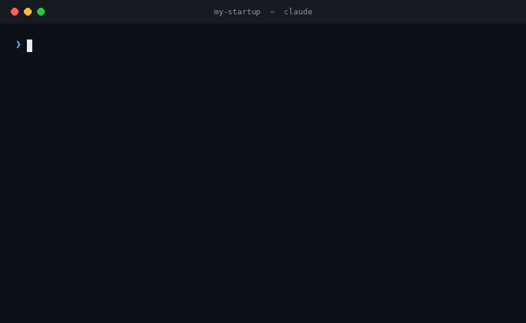

<div align="center">

# AI-Consultant

**Your vibe-coded app works on your laptop. Is it ready for a paying customer?**

An open-source IT consultant for founders. It reads your code against 170 production checks and tells you what to fix first, what it can't verify, and which humans you still need.

[](https://github.com/adibM04/AI-Consultant/actions/workflows/ci.yml)
[](LICENSE)




<sub>A replay of a real run on a deliberately broken sample app. The findings come from [`examples/real-run`](examples/real-run).</sub>

</div>

## Install

```
/plugin marketplace add adibM04/AI-Consultant
/plugin install ai-consultant@ai-consultant
```

Then, in your project, in Claude Code:

```
/ai-consultant:consult
```

It detects your stack, asks a few questions (patients? cards? EU customers? enterprise buyers?), audits in parallel, and writes `.consultant/REPORT.md`. You can also just ask: *"is my app ready for paying customers?"* Needs Python 3, nothing else.

<details>
<summary><b>No project to try it on? Audit a deliberately broken app first</b></summary>

<br>

```
git clone https://github.com/adibM04/AI-Consultant
cd AI-Consultant/examples/vibe-coded-app
claude
> /ai-consultant:consult
```

Pick `launch` and answer "yes" to payments. You should get `NOT READY`, with the SQL injection, the unauthenticated invoices, the MD5 passwords and the hard-coded key, each with a line number. It is a 50-line file, so nothing real is at stake. In our runs a five-domain audit cost about $0.70 and took about two minutes; all 14 domains of a bigger project cost more. Delete the generated `.consultant/` folder afterwards.

Prefer to read first? [`examples/real-run`](examples/real-run) is the unedited output, plus a questionnaire draft.

</details>

## What you get

- **A verdict** (`NOT READY`, `NOT VERIFIED`, `CONDITIONAL`, `READY`) computed by fixed, tested rules, not by the model's mood
- **What is broken**, with `file:line` evidence and the smallest fix
- **What it could not verify from code** (backups, DNS, contracts, on-call) as concrete questions for you
- **Which humans you still need**, because some of this is not a code problem

It reviews. It does not rewrite your app, and it will never tell you your app is "secure" or "compliant".

## Commands

| Command | Use it for |
|---|---|
| `/ai-consultant:consult` | Full audit |
| `/ai-consultant:consult-audit identity payments` | Re-check specific areas after fixing things |
| `/ai-consultant:consult-roadmap` | Turn the report into an ordered plan with sizes, owners and what is safe to do with AI |
| `/ai-consultant:consult-ask "do I need SOC 2?"` | Plain-English advice grounded in your repo; records accepted risks with an expiry |
| `/ai-consultant:consult-evidence` | Prove what code can't show (a restore test, key rotation) as a signed, expiring attestation |
| `/ai-consultant:consult-questionnaire q.csv` | Draft an enterprise buyer's security questionnaire, capped by what the audit can prove |

## Why you can trust the verdict

An AI auditor that wants to please you is worse than none. So the important rules are enforced in code, not requested in a prompt:

- **The verdict is computed**, not written. One failed critical item means `NOT READY`, always.
- **A "pass" must point at a real file and line.** Anything else is downgraded to "unknown".
- **A hostile repo can't talk it into passing.** It is tested against a repository whose README and `CLAUDE.md` order the auditor to approve everything, with planted waivers and fake secrets ([`evals/`](evals/)).
- **It says "unknown" instead of guessing.** Questionnaire answers can never claim more than the audit proves.

## Go deeper

| | |
|---|---|
| [What it checks](docs/checklist.md) | The 170 items in 14 domains, scoped by stage and product |
| [How it works](docs/how-it-works.md) | The pipeline, deterministic fact-gathering, and stack playbooks for Supabase, Firebase, Next.js and Stripe |
| [Evidence and questionnaires](docs/evidence-and-questionnaires.md) | Closing the unknowns, answering a buyer honestly |
| [CI](docs/ci.md) | A GitHub Action that checks every pull request against your last audit |
| [Limits](docs/limits.md) | What it cannot do, and using it with other agents |
| [Changelog](CHANGELOG.md) | What changed, and exactly what has and hasn't been verified |

## Honest limits

It reads code and config, so it can't see your cloud console, contracts or who has the pager; those become questions. It is a language model reading files, so it will miss things: treat a clean report as "no known gaps in what was checked", never as safety. It is not a penetration test, an audit, or legal advice. [More](docs/limits.md).

## Contributing

The best contributions are battle scars: the failure that cost you a weekend, written as a checklist item. See [CONTRIBUTING.md](CONTRIBUTING.md).

## License

MIT. See [LICENSE](LICENSE).
